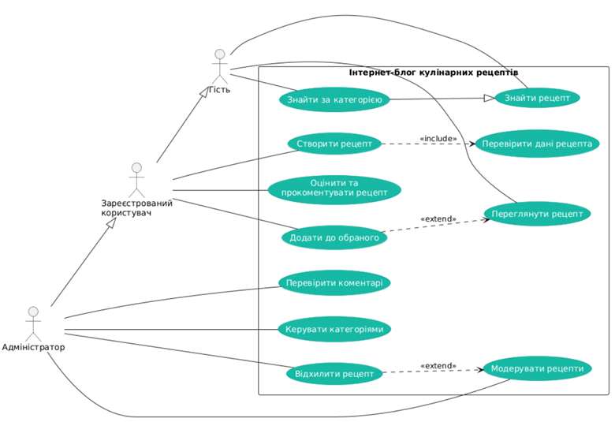
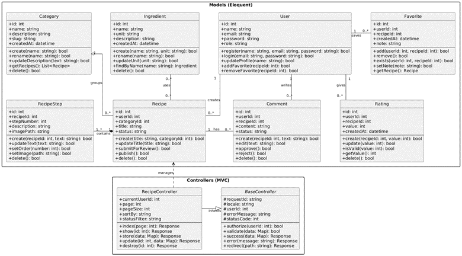

# Архітектура вебсистеми «Інтернет-блог кулінарних рецептів»

## 1. Опис системи

Інтернет-блог кулінарних рецептів — вебзастосунок для створення, публікації, пошуку та перегляду рецептів.

Основні функції:
- Реєстрація та авторизація користувачів.
- Створення, редагування та видалення рецептів.
- Пошук рецептів за назвою та категорією.
- Оцінювання та коментування рецептів.
- Додавання рецептів до обраного.
- Модерація рецептів адміністратором.

### Користувачі системи

1. **Гість** — переглядає та шукає рецепти.
2. **Зареєстрований користувач** — створює рецепти, залишає коментарі та оцінки.
3. **Адміністратор** — керує категоріями, рецептами та коментарями.

### Архітектура

Система проєктується на базі PHP/Laravel з використанням архітектурного шаблону MVC:

- **Model** — робота з даними через Eloquent ORM.
- **View** — відображення інтерфейсу за допомогою Blade.
- **Controller** — обробка HTTP-запитів і керування логікою системи.

Для зберігання інформації передбачається використання MySQL.

## 2. Use Case: Створити та подати кулінарний рецепт

**Scope:** Інтернет-блог кулінарних рецептів (System).

**Level:** User-goal.

**Primary Actor:** Зареєстрований користувач.

**Stakeholders and interests:**
- Користувач — публікація власного рецепта.
- Адміністратор — перевірка якості контенту.

**Preconditions:** Користувач зареєстрований та авторизований.

**Success guarantee:** Рецепт збережено зі статусом `pending` та передано на модерацію.

### Main Success Scenario

1. Користувач відкриває особистий кабінет.
2. Переходить до розділу «Мої рецепти».
3. Натискає «Додати рецепт».
4. Система відкриває форму створення рецепта.
5. Користувач вводить назву та опис страви.
6. Обирає категорію рецепта.
7. Вказує час приготування.
8. Додає інгредієнти та їх кількість.
9. Заповнює покрокову інструкцію.
10. Завантажує фотографію.
11. Натискає «Подати на модерацію».
12. Система перевіряє введені дані.
13. Система зберігає рецепт зі статусом `pending`.
14. Користувач отримує повідомлення про успішне збереження.

### Extensions

1. **Не заповнено обов'язкові поля:** система пропонує заповнити відсутні дані.
2. **Некоректний формат фотографії:** система відхиляє файл.
3. **Некоректна кількість інгредієнтів:** система вимагає виправити значення.
4. **Скасування створення:** система закриває форму без збереження.
5. **Помилка збереження:** система повідомляє про збій і пропонує повторити спробу.

**Special Requirements:** Перевірка даних, підтримка JPEG/PNG/WebP, захист від несанкціонованого доступу.

**Technology and Data Variations List:** PHP/Laravel, MySQL, Eloquent ORM, Blade.

**Frequency of Occurrence:** Залежить від активності зареєстрованих користувачів.

**Miscellaneous:** У майбутньому можливе збереження чернеток рецептів.

## 3. Діаграма варіантів використання

## 4. Діаграма класів

